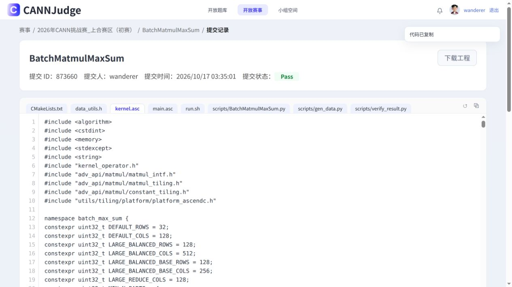

# 仅OJ优化收尾结论（2026-10-17）

本轮选用 **AG：列块末重复向量屏障删减**，已合入当前工作分支。停止新增优化探索和OJ评测。

AG两轮综合均分 **59.28556614**；P基线六轮均分 **58.66475276**，提高 **0.62081337分（综合分相对提高1.0582%）**。这里的百分比是得分变化，不是耗时变化。

所有轮次统一使用下表最新TBest，先逐点算分，再求每轮15点均值，最后平均各轮分数。没有挑选某次最高值，也没有先平均耗时再算分。公式为 `100 / (1 + ln(t/TBest) / ln(1.5))`；这是统一公式计算分，不是直接读取的榜单分。

## 逐点汇总

单位为微秒。平台最优固定第一行，其后按所绑定Git提交时间倒序，同提交的复测按提交时间倒序。

| 版本 | 源码提交 | OJ | 1 | 2 | 3 | 4 | 5 | 6 | 7 | 8 | 9 | 10 | 11 | 12 | 13 | 14 | 15 | 统一公式分 |
| --- | --- | --- | ---: | ---: | ---: | ---: | ---: | ---: | ---: | ---: | ---: | ---: | ---: | ---: | ---: | ---: | ---: | ---: |
| 平台TBest | 本轮最新快照 | — | 0.99 | 1.47 | 1.92 | 2.48 | 3.42 | 6.08 | 6.26 | 24.59 | 46.46 | 61.58 | 65.53 | 80.07 | 7.64 | 8.10 | 6.19 | — |
| AI | 771e0948 | [873706](https://cannjudge.cn/public/op_challenge_shanghe_prelim/batchmatmulmaxsum/submission/6ad27d2f193e507d8ec9b883) | 1.84 | 2.19 | 2.18 | 2.60 | 4.79 | 9.78 | 7.06 | 39.20 | 68.88 | 80.20 | 82.49 | 104.63 | 8.98 | 10.36 | 10.78 | 59.41624833 |
| AH | d455effb | [873420](https://cannjudge.cn/public/op_challenge_shanghe_prelim/batchmatmulmaxsum/submission/6ad27849193e507d8ec5061f) | 1.70 | 2.13 | 2.16 | 2.62 | 4.64 | 10.13 | 7.34 | 38.82 | 67.97 | 81.02 | 82.12 | 104.24 | 9.28 | 10.34 | 10.94 | 59.23141605 |
| AF | 37a5f6e3 | [873323](https://cannjudge.cn/public/op_challenge_shanghe_prelim/batchmatmulmaxsum/submission/6ad276b3193e507d8ec3b3dc) | 1.70 | 2.21 | 2.27 | 2.63 | 4.90 | 9.80 | 7.12 | 40.12 | 69.60 | 86.38 | 82.58 | 106.96 | 9.36 | 10.22 | 11.18 | 57.89625980 |
| AG2 | 2699a123 | [873660](https://cannjudge.cn/public/op_challenge_shanghe_prelim/batchmatmulmaxsum/submission/6ad27c65193e507d8ec8dfeb) | 1.73 | 2.12 | 2.32 | 2.53 | 4.55 | 9.60 | 7.13 | 39.88 | 70.73 | 80.83 | 82.37 | 104.09 | 9.63 | 10.42 | 10.87 | 59.06256920 |
| AG | 2699a123 | [873370](https://cannjudge.cn/public/op_challenge_shanghe_prelim/batchmatmulmaxsum/submission/6ad27781193e507d8ec464f8) | 1.74 | 2.15 | 2.23 | 2.61 | 4.79 | 9.94 | 7.05 | 38.66 | 70.78 | 81.03 | 81.85 | 103.77 | 8.84 | 10.28 | 10.80 | 59.50856308 |
| AE2 | 50f11cda | [873607](https://cannjudge.cn/public/op_challenge_shanghe_prelim/batchmatmulmaxsum/submission/6ad27ba5193e507d8ec80b56) | 1.77 | 2.26 | 2.18 | 2.67 | 4.66 | 9.70 | 7.16 | 39.13 | 68.75 | 81.35 | 81.83 | 104.07 | 9.46 | 10.27 | 11.10 | 58.68667379 |
| AE | 50f11cda | [873275](https://cannjudge.cn/public/op_challenge_shanghe_prelim/batchmatmulmaxsum/submission/6ad275e6193e507d8ec305ae) | 1.76 | 2.14 | 2.20 | 2.61 | 4.68 | 9.82 | 7.15 | 39.25 | 68.49 | 82.65 | 82.27 | 104.47 | 8.90 | 10.20 | 10.86 | 59.51147845 |
| AC | d8a7beec | [873218](https://cannjudge.cn/public/op_challenge_shanghe_prelim/batchmatmulmaxsum/submission/6ad27519193e507d8ec2437b) | 1.79 | 2.16 | 2.20 | 2.67 | 4.95 | 9.81 | 7.18 | 39.48 | 70.35 | 82.96 | 82.34 | 104.14 | 9.44 | 10.52 | 11.01 | 57.99874040 |
| AD | 6f8d40c0 | [872943](https://cannjudge.cn/public/op_challenge_shanghe_prelim/batchmatmulmaxsum/submission/6ad2713f193e507d8ebe7a44) | 1.72 | 2.21 | 2.25 | 2.63 | 4.74 | 9.94 | 7.17 | 38.85 | 70.29 | 82.08 | 82.49 | 104.66 | 8.90 | 10.17 | 10.75 | 58.99991117 |
| AA3 | d583c6ea | [873520](https://cannjudge.cn/public/op_challenge_shanghe_prelim/batchmatmulmaxsum/submission/6ad27a07193e507d8ec6a120) | 1.75 | 2.08 | 2.40 | 2.60 | 4.90 | 10.00 | 7.14 | 39.40 | 68.49 | 81.10 | 82.46 | 103.66 | 9.26 | 9.94 | 11.13 | 58.65876831 |
| AA2 | d583c6ea | [873163](https://cannjudge.cn/public/op_challenge_shanghe_prelim/batchmatmulmaxsum/submission/6ad2744c193e507d8ec15c17) | 1.70 | 2.29 | 2.25 | 2.59 | 4.80 | 9.66 | 7.21 | 39.02 | 69.88 | 82.53 | 81.91 | 103.58 | 9.18 | 10.18 | 10.78 | 58.89874712 |
| AA | d583c6ea | [872808](https://cannjudge.cn/public/op_challenge_shanghe_prelim/batchmatmulmaxsum/submission/6ad26f7d193e507d8ebcb3ff) | 1.71 | 2.18 | 2.23 | 2.58 | 4.67 | 9.74 | 7.11 | 38.66 | 69.16 | 81.31 | 82.41 | 104.39 | 9.12 | 10.25 | 10.94 | 59.48182866 |
| Y2 | 772d04a6 | [872665](https://cannjudge.cn/public/op_challenge_shanghe_prelim/batchmatmulmaxsum/submission/6ad26daa193e507d8ebaec22) | 1.73 | 2.12 | 2.20 | 2.65 | 4.76 | 9.82 | 7.18 | 41.00 | 69.50 | 80.66 | 82.90 | 103.68 | 9.39 | 10.38 | 10.67 | 58.72594025 |
| Y | 772d04a6 | [872395](https://cannjudge.cn/public/op_challenge_shanghe_prelim/batchmatmulmaxsum/submission/6ad26a22193e507d8eb76d29) | 1.70 | 2.10 | 2.21 | 2.64 | 4.87 | 9.75 | 7.00 | 42.03 | 69.62 | 81.15 | 82.20 | 104.51 | 9.22 | 10.24 | 10.85 | 59.04758485 |
| U3 | 53031024 | [872618](https://cannjudge.cn/public/op_challenge_shanghe_prelim/batchmatmulmaxsum/submission/6ad26ce1193e507d8eba40c2) | 1.68 | 2.14 | 2.17 | 2.78 | 4.85 | 9.63 | 6.93 | 39.90 | 70.68 | 82.93 | 82.45 | 105.24 | 9.46 | 10.24 | 10.98 | 58.46161829 |
| U2 | 53031024 | [872090](https://cannjudge.cn/public/op_challenge_shanghe_prelim/batchmatmulmaxsum/submission/6ad2661e193e507d8eb36c5c) | 1.81 | 2.15 | 2.28 | 2.70 | 4.67 | 9.78 | 7.00 | 38.41 | 69.11 | 80.65 | 82.07 | 103.97 | 9.10 | 10.25 | 10.48 | 59.04244927 |
| U | 53031024 | [871821](https://cannjudge.cn/public/op_challenge_shanghe_prelim/batchmatmulmaxsum/submission/6ad26327193e507d8eb0456d) | 1.73 | 2.15 | 2.14 | 2.66 | 4.72 | 9.86 | 7.12 | 38.32 | 70.57 | 81.09 | 81.56 | 103.52 | 9.42 | 10.31 | 10.86 | 59.22285162 |
| P6 | 645a8bc5 | [873567](https://cannjudge.cn/public/op_challenge_shanghe_prelim/batchmatmulmaxsum/submission/6ad27ad3193e507d8ec74f15) | 1.75 | 2.12 | 2.29 | 2.71 | 4.71 | 9.86 | 7.08 | 38.92 | 70.55 | 80.93 | 82.86 | 104.25 | 9.31 | 10.15 | 10.92 | 58.46953007 |
| P5 | 645a8bc5 | [873467](https://cannjudge.cn/public/op_challenge_shanghe_prelim/batchmatmulmaxsum/submission/6ad2792f193e507d8ec5df72) | 1.76 | 2.16 | 2.16 | 2.73 | 4.82 | 9.81 | 7.23 | 40.31 | 69.19 | 82.54 | 82.49 | 104.86 | 9.29 | 10.42 | 11.25 | 58.11948952 |
| P4 | 645a8bc5 | [873055](https://cannjudge.cn/public/op_challenge_shanghe_prelim/batchmatmulmaxsum/submission/6ad272bf193e507d8ebfdc21) | 1.70 | 2.28 | 2.27 | 2.65 | 4.97 | 9.78 | 7.07 | 40.02 | 71.18 | 81.68 | 82.21 | 104.77 | 9.53 | 10.30 | 11.09 | 57.89718125 |
| P3 | 645a8bc5 | [872473](https://cannjudge.cn/public/op_challenge_shanghe_prelim/batchmatmulmaxsum/submission/6ad26b08193e507d8eb86848) | 1.82 | 2.23 | 2.32 | 2.61 | 4.60 | 9.78 | 7.08 | 40.17 | 69.05 | 80.83 | 82.33 | 104.80 | 8.91 | 10.22 | 10.94 | 58.94600888 |
| P2 | 645a8bc5 | [871380](https://cannjudge.cn/public/op_challenge_shanghe_prelim/batchmatmulmaxsum/submission/6ad25e50193e507d8eaaf411) | 1.69 | 2.22 | 2.27 | 2.60 | 4.82 | 9.94 | 7.07 | 38.93 | 70.08 | 80.78 | 82.13 | 104.75 | 9.26 | 10.18 | 11.20 | 58.83557832 |
| P | 645a8bc5 | [871223](https://cannjudge.cn/public/op_challenge_shanghe_prelim/batchmatmulmaxsum/submission/6ad25cb4193e507d8ea913be) | 1.69 | 2.25 | 2.18 | 2.59 | 4.86 | 9.46 | 6.94 | 38.85 | 69.03 | 81.43 | 81.77 | 103.54 | 9.17 | 10.43 | 10.58 | 59.72072854 |

## 多轮取舍

|版本|成功轮数|综合均分|本轮结论|
|---|---:|---:|---|
|两轮AG|2|59.28556614|采用|
|两轮AE|2|59.09907612|未采用|
|三轮AA|3|59.01311470|未采用|
|三轮U|3|58.90897306|未采用|
|两轮Y|2|58.88676255|未采用|
|六轮P|6|58.66475276|未采用|
|AI首轮|1|59.41624833|仅一轮，稳定性未确认；未采用|
|AH首轮|1|59.23141605|未采用|
|AD首轮|1|58.99991117|未采用|
|AC首轮|1|57.99874040|未采用|
|AF首轮|1|57.89625980|未采用|

AG是完成多轮复测的候选中均分最高者，两轮均为15/15 Pass。小样本及不同时间窗口仍存在波动，本结论不宣称统计显著或绝对最优。AI首轮59.41624833分略高于AG均分，但缺少复测，不能据单轮值确认稳定优势。

AI2在提交前已核对同源，平台随后提示“今日提交次数已达上限（50次），请于北京时间2026-10-18 00:00后再提交”。本次未产生提交ID或评测结果，不计入成功轮次；按用户尽快收尾的要求采用已复测的AG，不等待额度刷新后自动继续。

[每日限额原始证据](evidence/oj-final-20261017/AI2-rejected.json) · [限额截图](evidence/oj-final-20261017/AI2-rejected.png)

## 改动、验证与交付

AG独立基于P，仅在Compute、ComputeResidentA、ComputeGeneric的列块末省去重复PIPE_V，保留紧随的PIPE_ALL；分段路径保留中间段同步。原矩阵计算、归约次序、布局及Host路由保持原实现，没有新增精确shape/K/tiling匹配。

本地完整编译65.991522秒成功，独立审查通过。OJ 873370、873660均15/15 Pass，提交前编辑器和结果页源码均逐字节一致。两轮点击提交至首次观察Pass的上界为99.853秒、96.283秒，因此两次远端编译均满足不超过300秒的要求；这两个数不是编译净耗时。未运行NPU或仿真。

生产源码提交：`2699a12342074060a9c9ec45310b7ba5d83f31f4`。正式合入提交：`bbf7228adbf911b8b2fdd01fee89c3e2a3798593`。分支：`codex/port-remote-optimizations-20261010`。尚未推送远端。

当前 `src/kernel.asc` SHA256：`fd70bc5ab1a32a04f5057cf0018542af1460548c2e12282f4303498535c5f436`，与两轮已提交的AG源码一致。原有三个未跟踪文档保留。

[AG具体改动与独审](列块末重复向量屏障候选AG-20261017.md) · [最终对照数据](evidence/oj-final-20261017/最终选择.json) · [第二轮OJ源码绑定](evidence/oj-final-20261017/AG2-identity.json)

